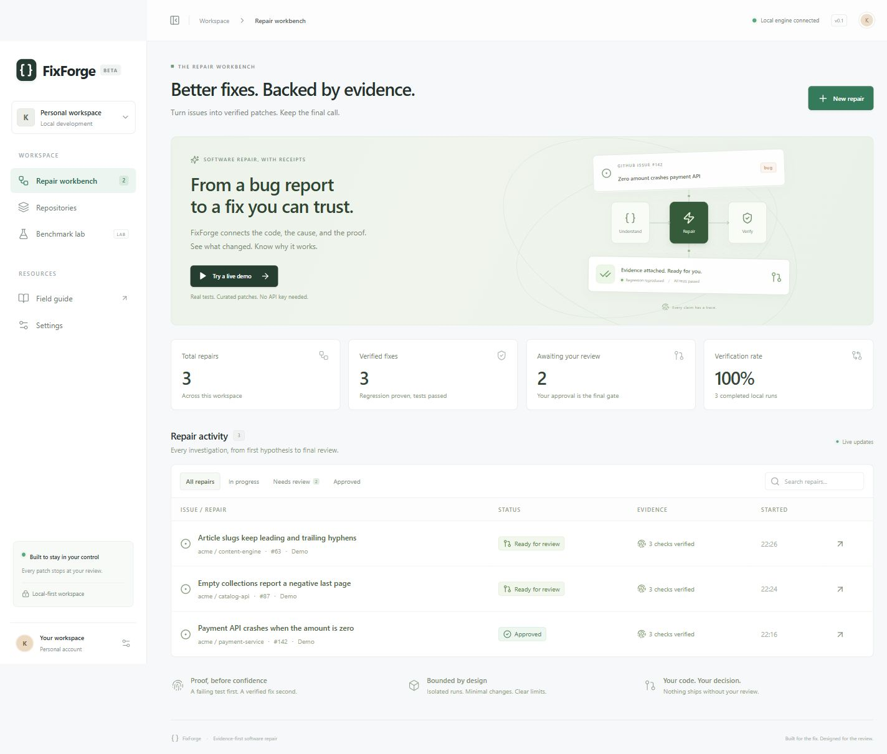

# FixForge

**Evidence-first software repair. From issue to verified patch, with a human at the review gate.**

FixForge is a local developer workbench that investigates a defect, proposes a bounded code change, proves a regression fails before the change and passes after it, and prepares a review package.

The local v0.2 release supports Python repositories with standard-library dependencies and `unittest`. An approved Ollama repair passed all four Docker verification gates and was packaged as a reproducible Git commit. The bundled demos let you try the workbench without configuring a model. See the [development log](docs/DEVELOPMENT_LOG.md) for the live pilot and test results.



The [v0.2 verification preview](docs/screenshots/verification-v02.jpg) shows all four gates and named outcomes; the [evidence preview](docs/screenshots/evidence-v02.jpg) shows the new source and inference receipts.

## Run it

Requires Python 3.11+ and Node.js 20.19+ / 22.12+. The curated demo needs no API key or Docker.

On Windows, from this folder:

```powershell
.\start.ps1
```

If your PowerShell policy disallows scripts, use the manual commands below. There is no need to change the policy.

```powershell
python -m venv .venv
.\.venv\Scripts\python.exe -m pip install -r requirements.lock
cd web
npm ci
npm run build
cd ..
.\.venv\Scripts\python.exe -m fixforge
```

On macOS/Linux, replace `.venv\Scripts\python.exe` with `.venv/bin/python`.

Open **[http://127.0.0.1:8000](http://127.0.0.1:8000)** and select **Try a live demo**. The API reference is at [http://127.0.0.1:8000/docs](http://127.0.0.1:8000/docs).

The app persists run history, test logs, source receipts and patch snapshots in `.fixforge/`. It binds to loopback and supports one local operator. Keep one server process running for each data directory.

## What works today

- React/TypeScript repair workbench with live run updates, search, activity filters and a review gate.
- Python AST indexing: functions, classes, imports, source hashes and lexical relevance ranking.
- A bounded repair state machine with SQLite history and interrupted-worker recovery.
- Three curated demo cases running actual Python tests: zero-value payments, empty pagination and whitespace normalization.
- Local Ollama and OpenAI Responses adapters with structured proposals, local schema validation, one bounded attempt and usage receipts for standard-library Python repositories.
- Local source review before inference. The review binds the issue text and Python files to the model and source revision.
- Public/private GitHub **issue reading**, with an optional server-side token.
- Separate original and patched snapshots; your checkout remains untouched.
- Four verification gates: existing named tests pass; new regression fails on original code while existing tests stay green; the identical named suite passes after the fix; restoring original production code reproduces the same failures.
- Failure classification rejects test-authoring, collection, dependency/import and interrupted execution errors as defect proof.
- Git commit/status and Python-content fingerprints, checked during capture, before sealing evidence and again before approval of repository repairs.
- Docker runner for all repository/AI code; no local fallback. Trusted, fixed demo code can use local Python.
- Evidence v3 binds the source revision, issue, explanation, provider receipt, patch, test logs and execution environment to a linked event history. Every Docker check in a run uses the same local image ID and records it alongside the test harness hash.
- Approval/rejection bound to the exact verified patch digest.
- Downloads: unified `.patch`, full evidence `.json`, and a Markdown review description.
- Local Git handoff for an approved repair at a clean commit, with the patch and evidence in one ZIP.
- Local benchmark metrics with demo and AI run counts explicitly separated.

## Try a real repository

v0.2 supports **small Python repositories using standard-library dependencies and `unittest`**, with 1–200 discovered tests under `tests/test_*.py` (including the generated regression). Use `tests/__init__.py` for portable discovery and package subdirectories. Only Python files are copied; configuration, assets, data and installed dependencies are not copied. Limit: 200 files, 2 MB in total, 64 KB per file.

1. Copy `.env.example` to `.env` if you haven't already created it.
2. Choose [local Ollama](#run-ollama-locally) or set `OPENAI_API_KEY` and `FIXFORGE_MODEL` for OpenAI.
3. Register a repository path in `FIXFORGE_REPOSITORIES`. The UI accepts registered IDs only.
4. Start Docker Desktop with the Linux engine, then pull `python:3.11-slim` (or the image configured in `.env`). Tests never pull images automatically.
5. Restart the FixForge server. Select **New repair → AI repository repair**.
6. Supply an issue title and reproduction, or a GitHub issue URL. Match the selected checkout to the issue repository.
7. If you already have a failing test, expand **Supply a regression test** and paste a complete Python `unittest` module. The model proposes the production edits. Leave the field blank to ask the model for both the edits and the test.
8. Select **Review source** to inspect what the model will receive, including any supplied test. Select **Start local repair** for Ollama or **Send to OpenAI and start** for OpenAI. Changes to the issue, test, checkout, or inference provider require a new review.

Example configuration:

```dotenv
OPENAI_API_KEY=your-key-here
FIXFORGE_MODEL=gpt-4.1
FIXFORGE_REPOSITORIES={"my-api":"C:/dev/my-api"}
```

The preview works without a running model or Docker. It shows the issue text, optional regression and up to 20 ranked Python files. The test shares the source budget with the selected files. FixForge blocks common credential patterns and checks supplied tests against its Python test policy. All repairs go through the same four verification gates. The inference receipt records the model, reviewed digest, file paths and token counts when the provider reports them.

### Run Ollama locally

Start the Linux Docker engine. Run these commands once to start Ollama and download the model:

```powershell
docker run --detach --name fixforge-ollama --restart unless-stopped --publish 127.0.0.1:11434:11434 --volume fixforge-ollama-models:/root/.ollama --env OLLAMA_NO_CLOUD=1 --env OLLAMA_NUM_PARALLEL=1 ollama/ollama:0.40.17
docker exec fixforge-ollama ollama pull qwen3:4b
```

A native Ollama installation also works. Start it with `OLLAMA_NO_CLOUD=1` and pull `qwen3:4b`. FixForge connects directly to `127.0.0.1:11434` and checks that the configured model is local. [Ollama on Windows](https://docs.ollama.com/windows) · [Ollama local-only mode](https://docs.ollama.com/faq#how-do-i-disable-ollamas-cloud-features)

For the portable Windows release, run this from the folder containing `ollama.exe`. Keep it running while you use FixForge.

```powershell
$env:OLLAMA_NO_CLOUD = '1'
$env:OLLAMA_HOST = '127.0.0.1:11434'
.\ollama.exe serve
```

Set these variables in the existing `.env`, then restart FixForge. Ollama requires no API key.

```dotenv
FIXFORGE_INFERENCE_PROVIDER=ollama
FIXFORGE_OLLAMA_MODEL=qwen3:4b
```

Run `python -m fixforge doctor` to check the model, registered checkout and Docker test image. Use `docker start fixforge-ollama` to restart the container if you stopped it manually.

## Bound inference requests

Configure `FIXFORGE_MAX_OUTPUT_TOKENS` (256–16,000) and `FIXFORGE_MAX_CONTEXT_CHARS` (1,000–120,000) in `.env`. OpenAI defaults are 10,000 output tokens, 90,000 selected source characters and a 90-second request timeout (`FIXFORGE_PROVIDER_TIMEOUT_SECONDS`, 5–120). Ollama caps the shared budgets at 4,096 output tokens and 16,000 selected source characters and uses an 8,192-token context window. Its default timeout is 300 seconds (`FIXFORGE_OLLAMA_TIMEOUT_SECONDS`, 5–600) to allow local hardware time to generate a repair. Each run makes one model attempt. Reported token usage is retained even for incomplete or schema-invalid provider responses when available.

The workbench shows named outcomes and a reason for each gate. Source, inference and execution receipts appear in the Evidence record. Earlier records remain readable. Start a new run to capture the execution receipt.

## Pilot repository

The [scheduling pilot](examples/pilot/README.md) contains three bugs and five passing baseline tests. Run `python -m fixforge doctor` from the project environment to check the configured provider, registered repositories, Linux Docker engine and pre-pulled image.

For the separate Docker smoke test, pre-pull `python:3.11-slim`, set `FIXFORGE_TEST_DOCKER=1`, and run `python -m pytest -q tests/test_real_repository.py -k test_docker_runs_all_four_gates`. It exercises all four gates with a fixture patch and needs no provider key. The Linux CI job runs the same check.

## Prepare a Git handoff

After approving a repository repair, copy its run ID from the workbench and run this from the FixForge folder.

```powershell
.\.venv\Scripts\python.exe -m fixforge handoff RUN_ID
```

The command requires a registered Git repository root at the same clean commit and Python source snapshot used for verification. Git must have the base objects locally. The ZIP appears under `.fixforge/handoffs/` (or under the configured data directory). It contains `repair.bundle`, the approved diff, the evidence JSON, the review description, and `handoff.json` with the base commit, prepared commit, branch and hashes.

To import the prepared branch, extract the ZIP and run these commands in a clone that contains the recorded base. Use the branch name printed by the handoff command or listed in `handoff.json`.

```powershell
$bundle = 'C:/path/to/extracted/repair.bundle'
$branch = 'codex/fixforge-RUN_ID'
git bundle verify $bundle
git fetch --no-tags $bundle "refs/heads/${branch}:refs/heads/${branch}"
git show --stat $branch
```

Git imports the branch while keeping the current checkout in place. See the [Git bundle reference](https://git-scm.com/docs/git-bundle) for its base-commit prerequisites.

## Development

Build the UI once before starting the Python server. During UI development, run the engine on port 8000 and Vite in a second terminal:

```powershell
cd web
npm run dev
```

Vite proxies `/api` to the engine. Open the printed local port 5173 URL. The main Python app serves the production build at port 8000.

```powershell
.\.venv\Scripts\python.exe -m pytest -q
cd web
npm run build
```

Tests execute the real fail-before/pass-after workflow and negative verification paths, API review and exports, integrity checks, path restrictions, immutable tests and sandbox configuration. CI runs the backend suite and TypeScript/production build on Windows and Linux.

## Deliberate boundaries

This release does not clone arbitrary repositories, install repository dependencies, repair JavaScript, push branches, open GitHub PRs, merge code, or claim a general AI repair success rate. Approval and Git handoff preparation take place locally.

Docker resource restrictions and static AST checks reduce risk; neither makes this suitable for executing hostile public repositories as a shared service. Review [the threat model](docs/SECURITY.md) before enabling real runs.

## Project documents

- [Full product and delivery plan](docs/PROJECT_PLAN.md): differentiation, dated milestones, acceptance gates, evaluation, costs and launch plan.
- [Architecture](docs/ARCHITECTURE.md): workflow, modules, API, data and design decisions.
- [Security model](docs/SECURITY.md): trust boundaries and remaining risks.
- [Development log](docs/DEVELOPMENT_LOG.md): what was built and verified today.

## Technical references

The integration contracts follow the official [OpenAI Responses reference](https://developers.openai.com/api/reference/resources/responses/methods/create), [Docker run documentation](https://docs.docker.com/engine/containers/run/), and [GitHub pull request API reference](https://docs.github.com/en/rest/pulls/pulls). GitHub PR creation is a planned milestone, not implemented behavior.
