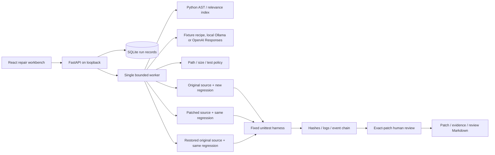

# Architecture

## Implemented system



Docker is mandatory for repository and AI runs. The curated demo uses fixed project-owned code and deterministic edits in local Python. Demo issue descriptions never become executable instructions.

## State machine

```text
queued → index → baseline → plan → reproduce → patch → verify (patch + restored-code replay) → evidence → review
                                                                       ↘ approve / reject
any execution failure → failed
restart with unfinished work → failed / interrupted
```

The four test gates record unique discovered test IDs, per-test outcomes, exception classes, failure categories and production traceback paths. A matching count with substituted IDs fails. Original tests must stay green during reproduction; import, collection and test-authoring errors cannot qualify as defect failures. Replay requires the same failing IDs and signatures.

The durable `status` is queued, running, review, approved, rejected or failed. `stage` identifies the finer-grained step. The worker runs one task at a time; the API allows a bounded waiting queue of four unfinished runs. There is no automatic retry. A retry creates a new record. Use one server process per data directory.

Run creation, record updates and review decisions use transactions. Review uses `BEGIN IMMEDIATE` to check state and digest before committing the decision. The initial event writer assumes one engine worker; durable distributed coordination is a later milestone.

## Modules

| Module | Responsibility |
|---|---|
| `config.py` | Local .env parsing, server configuration and repository allowlist |
| `api.py` | Local-only API, request validation, queue dispatch, review, downloads, metrics and UI assets |
| `engine.py` | Workflow and verification contract; never executes model-generated shell commands |
| `intelligence.py` | Bounded Python-only snapshots, safe paths, AST symbols/imports and relevance ranking |
| `proposals.py` | Strict structural output schema and local proposal type/size contract |
| `provenance.py` | Git/status/source fingerprints and checkout freshness validation |
| `handoff.py` | Approved repair to base-pinned Git commit, bundle and evidence ZIP |
| `disclosure.py` | Exact source preview, credential pattern checks and review digest |
| `verification.py` | Named-test identity, failure classification and counterfactual replay gates |
| `providers.py` | Deterministic fixture recipes, local Ollama and OpenAI adapters, GitHub issue reader |
| `policy.py` | Allowed existing production edits, immutable existing tests, syntax/heuristic AST checks |
| `sandbox.py` | Fixed commands, bounded logs/time and restricted Docker invocation |
| `harness.py` | unittest discovery and structured result report |
| `store.py` | SQLite transactions, event hashes, evidence validation, review decisions and recovery |
| `fixtures.py` | Three complete defect/original/fix/test recipes |
| `web/src` | React workbench, investigation, diff, logs, evidence, setup and benchmark views |

## Repository handling

The backend configuration maps short IDs to reviewed local paths. A browser cannot supply a raw path. A snapshot includes non-hidden `.py` files only, excluding dependency/build and metadata directories, symlinks and junctions. Hard caps: 200 files, 64 KB per file, 2 MB total. Source content is never imported into the control plane.

Indexing uses Python `ast` and lexical term overlap. Ranked context is limited to 20 files and the selected provider's source budget. The model is asked for complete replacement contents for at most five existing production files and one new unittest module.

`POST /api/source-preview` resolves the issue and returns the selected source, issue text and optional operator-supplied regression locally with `Cache-Control: no-store`. The review digest binds the provider, model, repository ID, snapshot identity, and input sent for inference. Run submission recomputes the digest, and the worker checks it again against its own snapshot before executing tests. The inference receipt records the digest and file paths under the existing provider record hash. With a supplied regression, the provider must return production edits only. The worker uses the reviewed test under its ordinary patch policy and four verification gates.

The original snapshot receives only the proposed new regression. The patched snapshot is copied from that state and receives production edits. Existing tests are unchanged in both. A third copy restores the original production edits after the patch passes; the same regression failures must return. Source identity includes the Git HEAD (when available), status digest, Python snapshot hash and per-file hashes. It captures supported Python content, not every binary or ignored non-Python file.

## Evidence

Each event is hashed over canonical JSON, sequence, timestamp, stage, title, detail and previous event hash. A manifest records the original source hash, patch hash, all test check/log hashes, an event-chain head, verification contracts, mode and limitations. A manifest hash covers the manifest itself excluding its hash field.

Approval checks the current run state, submitted patch digest and record integrity. For repository runs it rechecks source identity under the review transaction and rejects drift or an unregistered repository. The decision records source and manifest identities as well as the patch digest. The UI can export an intact verified run before or after review. A review package does not create a GitHub PR.

The local `handoff` command additionally binds the approval to the verified commit. It checks that the clean base tree contains the Python files used in verification and that each committed blob matches the captured source. It assembles one child commit in a temporary bare repository, preserving existing file modes and LF or CRLF line endings on modified files. It checks the changed paths, revalidates source freshness, and atomically writes a ZIP containing the incremental Git bundle and review evidence. The commit uses the approval timestamp so it can be reproduced for the same run.

Evidence v2 also binds issue metadata, root-cause explanation, source revision and the provider usage/limits receipt. Legacy v1 records remain inspectable; real-repository v1 approvals require a new run.

Evidence v3 adds the execution receipt. The worker resolves the configured Docker reference to a local SHA-256 image ID once and passes that ID to every gate. The receipt also records the architecture and test harness SHA-256. Demo receipts identify the local Python version. The worker checks the harness file before and after each gate. [Docker image inspection](https://docs.docker.com/reference/cli/docker/image/inspect/)

Local hashes detect accidental alteration and inconsistent artifacts. They do not establish externally verifiable authorship or resist an attacker who can rewrite the entire database and recompute the chain. The evidence directory and database contain source code and should be treated as private.

## API

| Method | Path | Purpose |
|---|---|---|
| GET | `/api/health` | Process readiness |
| GET | `/api/config` | Non-secret capability state and repository IDs |
| GET | `/api/fixtures` | Available curated cases |
| GET / POST | `/api/runs` | List runs / enqueue one bounded attempt |
| GET | `/api/runs/{id}` | Run, events, diff, checks and integrity result |
| POST | `/api/runs/{id}/review` | Exact-digest approval or rejection |
| GET | `/api/runs/{id}/export/patch` | Unified diff |
| GET | `/api/runs/{id}/export/evidence` | Full JSON record |
| GET | `/api/runs/{id}/export/review` | Markdown review description |
| GET | `/api/metrics` | Local observed run metrics |

The UI polls every 1.6 seconds. This is adequate for one operator; paginated summaries, event streaming and artifact separation become necessary as run count grows. Current list responses include full logs and file contents.

## Deployment decision

Keep this as a local application while building and validating the execution boundary. A static website or general edge Worker cannot execute repository test workloads. A hosted version needs a control plane plus separately isolated workers, a durable queue, authentication, database ownership and private artifact storage. This repository does not expose the app publicly or register hosting resources.

## Integration references

- [OpenAI Responses create](https://developers.openai.com/api/reference/resources/responses/methods/create): server-side HTTPS request, `store=false`, bounded output, JSON response.
- [Docker run](https://docs.docker.com/engine/containers/run/): network, filesystem, user, capability and resource controls.
- [GitHub issues](https://docs.github.com/en/rest/issues/issues): read issue details; no GitHub writes today.
- [GitHub pull requests](https://docs.github.com/en/rest/pulls/pulls): planned draft-PR publisher.

## v0.2 inference boundary

The Responses request uses a strict JSON schema for shape and rejects extra keys. Pydantic independently enforces local types, lengths and edit counts before policy checks or execution. Output and response bytes, selected context characters, request timeout and attempt count are bounded. Reported token usage is captured for successful, incomplete and schema-rejected responses when supplied by the provider; missing usage stays unknown. No dollar cap or live-model quality claim is implied.

Freshness checks are point-in-time observations, not filesystem locks. A future branch publisher must recheck source/base identity at publication and handle races independently.
